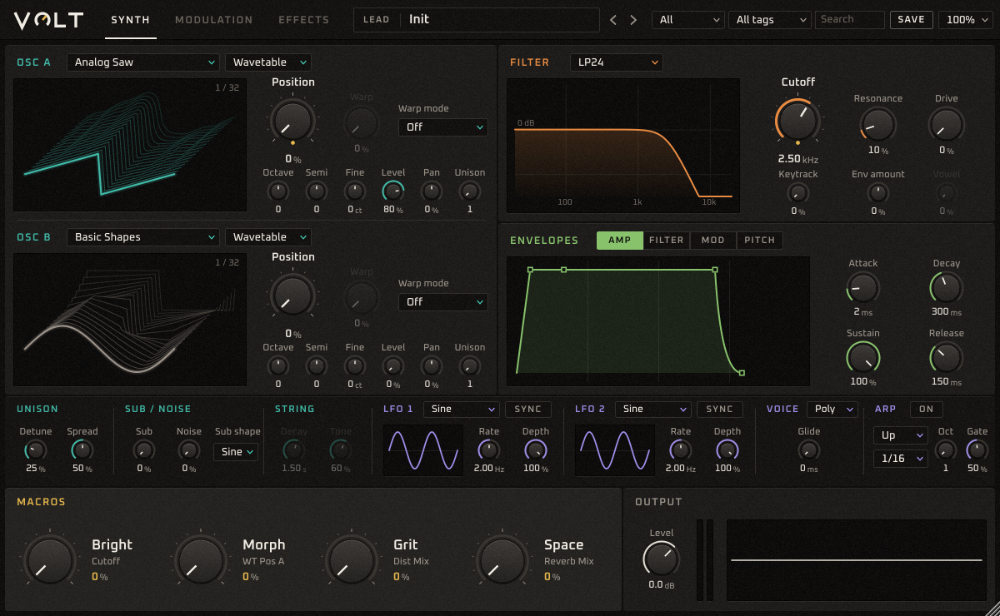

# VOLT

Syntezator wavetable (VST3 + Standalone) z czytelnym interfejsem, wykresami wszystkiego, co kształtuje dźwięk, i biblioteką
136 presetów (Init + 135 wybranych po odsłuchu): basy, leady, gitary, pady, klawisze, arpeggia, brassy i efekty.
Główny cel: **Windows x64 i FL Studio**. Darmowy i otwarty (AGPLv3), bez rejestracji.



Zakładki [MODULATION](docs/ui-modulation.png) i [EFFECTS](docs/ui-effects.png).

## Funkcje w skrócie

- **Silnik:** 16 głosów, tryby Poly / Mono / Legato, glide.
- **Oscylatory A i B:** 40 wavetable generowanych kodem (analogowe, supersaw, PWM, organowe, wokalne/formantowe,
  metaliczne, FM, zgrzytliwe, struny, fortepian, stroik, szkło), płynny morfing pozycji, mipmapy przeciw aliasingowi,
  oktawa / półtony / dostrojenie / poziom / panorama, unison do 8 głosów (Detune i Spread).
- **Warp każdego oscylatora:** Sync, Bend, Squeeze, Mirror, Quantize, FM i RM od drugiego oscylatora (z modulowanym
  Amount).
- **Oscylator String:** model szarpanej struny (Karplus-Strong) pobudzany kształtem wavetable – gitary, harfy, plucki;
  wspólne pokrętła Decay i Tone.
- **Sub** (sinus/trójkąt, oktawę pod Osc A) i **szum**.
- **Filtr na głos:** LP12, LP24, HP, BP, Notch, Ladder (rezonans w stylu acid), Formant (morfing samogłosek
  A-E-I-O-U, brzmienia w stylu talkboxa), Comb+ i Comb− (metaliczne rezonanse); Cutoff, Resonance, Drive,
  Key Track, Env Amount.
- **Obwiednie:** Amp ADSR, Filter ADSR, Mod Env (wolna obwiednia do dowolnego celu), Pitch Env (Amount, Decay)
  do 808 i zjazdów wysokości.
- **2 LFO** (sine, tri, saw, square, S&H; tempo sync, Rate, Depth, Retrigger).
- **Macierz modulacji:** 12 slotów (źródło, cel, ilość) wybieranych z list; źródła m.in. LFO, obwiednie, Velocity,
  Mod Wheel, Aftertouch, Key Track, Random (inna wartość dla każdej nuty), makra.
- **4 makra** z etykietami zapisywanymi w presecie.
- **Arpeggiator:** Up, Down, UpDown, Random; tempo, oktawy, gate.
- **Efekty (w tej kolejności):** Distortion (Soft, Tube, Hard, Fold, Bitcrush; 4× oversampling) → Mod FX
  (Chorus, Phaser, Flanger) → Pump (ducking zsynchronizowany z tempem) → Delay (stereo / ping-pong, sync) →
  Reverb → Squash (3-pasmowy kompresor na jednym pokrętle) → Output Gain + limiter ochronny.
- **Interfejs:** okno 1200×740 (skalowanie 75–200%) z zakładkami SYNTH / MODULATION / EFFECTS. Na zakładce SYNTH
  widać naraz oscylatory z podglądem wavetable, filtr z krzywą, obwiednie z wykresem, oba LFO, głos i arpeggiator.
  Makra, wyjście z miernikiem poziomu i oscyloskop są zawsze widoczne na dole. Każda sekcja ma własny kolor
  (oscylatory turkus, filtr pomarańcz, obwiednie zieleń, LFO i modulacja fiolet, efekty niebieski, makra bursztyn).

## Instalacja w FL Studio (Windows x64)

1. Pobierz **`VOLT-windows-x64.zip`**: na GitHubie wejdź w zakładkę **Actions**, otwórz najnowszy zielony przebieg
   workflow **CI** i w sekcji **Artifacts** kliknij `VOLT-windows-x64` (trzeba być zalogowanym na GitHubie).
2. Rozpakuj archiwum. W środku jest folder **`VOLT.vst3`** (plugin) i **`VOLT.exe`** (wersja Standalone).
3. Skopiuj **cały folder** `VOLT.vst3` do `C:\Program Files\Common Files\VST3\`
   (potrzebne uprawnienia administratora).
4. W FL Studio otwórz **Options → Manage plugins** i kliknij **Find installed plugins** (skanowanie).
   VOLT pojawi się w kategorii **Generators** (producent: *VOLT Instruments*). Zaznacz gwiazdkę, żeby był
   widoczny w menu dodawania instrumentów.
5. Dodaj instrument: w **Channel Rack** kliknij **+** i wybierz **VOLT**.
6. Presety wybierasz w górnym pasku okna VOLT (nie w menu presetów FL Studio – plugin udostępnia hostowi
   jeden „program”). Stan pluginu, w tym nazwa presetu i etykiety makr, zapisuje się w projekcie FL Studio.

Uwagi:
- Pliki nie są podpisane cyfrowo – Windows SmartScreen może ostrzec przy pierwszym uruchomieniu `VOLT.exe`.
- Plugin jest 64-bitowy (x64). Wersja ARM64 nie jest budowana.
- Pump, arpeggiator, LFO w trybie Sync i Delay biorą tempo z FL Studio. Gdy transport stoi, korzystają z tempa
  projektu i własnego zegara; przy odtwarzaniu synchronizują się z pozycją w takcie.

## Skrócona instrukcja

**Pokrętła**
- przeciąganie w górę/dół (lub w prawo/lewo) zmienia wartość, **Shift** = precyzyjna zmiana,
- **dwuklik** przywraca wartość domyślną, kółko myszy też działa,
- nazwa parametru jest nad pokrętłem, a **aktualna wartość zawsze pod nim**; po najechaniu pojawia się tooltip.

**Kolory sekcji** mówią, do czego należy kontrolka: turkus – oscylatory, unison, sub, szum i struna; pomarańcz –
filtr; zieleń – obwiednie; fiolet – LFO, macierz modulacji, arpeggiator, tryb głosu; niebieski – efekty; bursztyn –
makra. Kolor ma tytuł sekcji, łuk pokrętła i wykres. **Bursztynowa kropka pod pokrętłem** oznacza, że steruje nim
któreś makro.

**Układ okna:** u góry znak VOLT (kliknięcie: informacje o programie i licencji), zakładki i pasek presetów; na dole
zawsze widoczne MACROS, OUTPUT i oscyloskop.
1. **Pasek presetów:** kliknięcie nazwy otwiera menu presetów pogrupowane w kategorie, strzałki `<` `>` to
   poprzedni/następny (w obrębie aktywnego filtra), dalej filtry kategorii i tagów, wyszukiwarka (nazwa, tagi, opis),
   **SAVE** zapisuje preset użytkownika, lista **75–200%** zmienia rozmiar okna (można też przeciągnąć narożnik).
2. **Zakładka SYNTH:** OSC A / OSC B (wavetable, typ Wavetable/String, podgląd tablicy jako powierzchni, duże
   pokrętło Position, Warp i tryb warp, Octave, Semi, Fine, Level, Pan, Unison), FILTER (typ, krzywa, duże pokrętło
   Cutoff, Resonance, Drive, Keytrack, Env amount, Vowel), ENVELOPES (przełącznik AMP / FILTER / MOD / PITCH, wykres
   wybranej obwiedni i jej pokrętła), a pod spodem pasek: UNISON, SUB / NOISE, STRING (Decay i Tone dla oscylatorów
   w trybie String), LFO 1 i LFO 2 (kształt, Sync, Rate albo podział taktu, Depth), VOICE (Poly/Mono/Legato, Glide),
   ARP.
3. **Zakładka MODULATION:** LFO 1 i LFO 2 z dużymi pokrętłami i przełącznikiem Retrigger, MOD ENVELOPE oraz
   MODULATION MATRIX: 12 slotów źródło → cel z suwakiem ilości −100…+100%.
4. **Zakładka EFFECTS:** sześć efektów w kolejności łańcucha: 1 Distortion, 2 Mod FX, 3 Pump, 4 Delay, 5 Reverb,
   6 Squash.
5. **MACROS:** obok każdego pokrętła jest jego nazwa (dwuklik zmienia ją), cel albo cele, którymi steruje, i wartość.

**Presety użytkownika** zapisują się jako JSON w `%APPDATA%\VOLT\Presets` (na Linuksie `~/.config/VOLT/Presets`).
Można je kopiować między komputerami; po skopiowaniu wybierz *Rescan user presets* w menu presetów.

**Świadomie pominięte** (nie ma ich w specyfikacji): pitch bend i pedał sustain (CC64). Obsługiwane są Mod Wheel
i Aftertouch (jako źródła modulacji) oraz All Notes/Sound Off.

Lista presetów z opisami: [`docs/PRESETS.md`](docs/PRESETS.md). Kategorie: Bass, Lead, Guitar, Pad, Keys, Arp,
Brass, FX. Lista w menu presetów jest ułożona według kategorii, a w kategorii alfabetycznie; styl (np. „Industrial”,
„House”, „Cinematic”, „Lo-Fi”) wybierzesz w filtrze tagów.

## Co zostało zweryfikowane automatycznie, a co wymaga odsłuchu i testu w FL Studio

**Sprawdzane automatycznie w CI (GitHub Actions, każdy push; PR pokazuje wynik):**
- build na **Linuksie** (VST3, Standalone, testy, renderer) i **Windows x64** (VST3 i Standalone, MSVC),
- **testy jednostkowe DSP i pluginu** (`tests/`): pasmo mipmap wavetable, aliasing wysokich nut (< −50 dB),
  nachylenia i stabilność wszystkich typów filtra przy maksymalnym rezonansie i drive, czasy obwiedni,
  limit 16 głosów, Mono/Legato, wzorce i timing arpeggiatora, każdy typ przesteru, Pump, Delay, zanik pogłosu,
  Squash, sufit limitera, makra i macierz modulacji, fuzzing losowych parametrów (brak NaN/Inf), wydajność
  najgorszego przypadku, zapis/odczyt stanu sesji (wszystkie parametry, nazwa presetu, etykiety makr),
  zapis i wczytanie presetu użytkownika, poprawność wszystkich presetów fabrycznych (pola, kategorie, makra, zakazane nazwy),
- **render offline wszystkich presetów fabrycznych** (`VOLT_Render`): test nie przechodzi przy ciszy, NaN/Inf, szczycie
  > 0 dBFS, dużym DC, ogonie, który nie zanika, zbyt mocnej pracy limitera i niespójnej głośności; raport zawiera
  RMS, szczyt, głośność (LUFS), centroid widmowy i czas ogona (artefakt `VOLT-render-report`),
- **pluginval** (strictness 5) na Linuksie i Windows, w tym otwieranie edytora, zapis/odczyt stanu i automatyzacja
  parametrów,
- artefakty **`VOLT-windows-x64.zip`** (folder `VOLT.vst3` + `VOLT.exe`) i **`VOLT-preset-previews.zip`**
  (krótkie podglądy FLAC każdego presetu).

**Wymaga odsłuchu i ręcznego testu (nie da się tego sprawdzić w chmurze na Linuksie):**
- **charakter i jakość brzmień** – czy presety brzmią dobrze i wystarczająco różnie; najszybciej odsłuchać
  podglądy z `VOLT-preset-previews.zip`,
- **skanowanie i ładowanie w FL Studio**, zapis/odczyt projektu, automatyzacja parametrów z poziomu FL Studio,
  synchronizacja z tempem przy odtwarzaniu i zatrzymanym transporcie,
- **obsługa interfejsu na Windows:** przeciąganie, Shift, dwuklik, tooltipy, skalowanie 75–200% i ekrany HiDPI,
  okno zapisu presetu, katalog `%APPDATA%\VOLT\Presets`,
- **zużycie CPU w realnym projekcie** (test wydajności w CI mierzy tylko syntetyczny najgorszy przypadek),
- **Standalone na Windows** (wybór urządzenia audio/MIDI).

Interfejs był sprawdzany wyłącznie na zrzutach renderowanych bez ekranu (`VOLT_Render --snapshot`), a Standalone
tylko pod kątem uruchomienia bez awarii.

## Budowanie ze źródeł

Wymagania: CMake ≥ 3.22, kompilator C++20 (Visual Studio 2022 na Windows, GCC/Clang na Linuksie), Git.
JUCE 8.0.15 jest pobierany automatycznie (CMake FetchContent).

Windows:

```bash
cmake -S . -B build -A x64 -DVOLT_BUILD_TOOLS=OFF
```

```bash
cmake --build build --config Release --target VOLT_VST3 VOLT_Standalone
```

Wynik: `build/VOLT_artefacts/Release/VST3/VOLT.vst3` i `build/VOLT_artefacts/Release/Standalone/VOLT.exe`.

Linux (Ubuntu 24.04), z testami i rendererem:

```bash
sudo apt-get install -y ninja-build libasound2-dev libx11-dev libxrandr-dev libxinerama-dev libxcursor-dev libxcomposite-dev libxext-dev libxrender-dev libfreetype-dev libfontconfig1-dev xvfb
```

```bash
cmake -S . -B build -G Ninja -DCMAKE_BUILD_TYPE=Release
```

```bash
cmake --build build
```

```bash
ctest --test-dir build --output-on-failure
```

```bash
./build/VOLT_Render_artefacts/Release/VOLT_Render --out render-out
```

Presety są generowane skryptem `tools/presets/generate_presets.py` (opis procedury korekty poziomów
w `docs/PROGRESS.md`).

## Dokumentacja projektu

- [`docs/PRESETS.md`](docs/PRESETS.md) – lista presetów, kategorie, tagi, makra.
- [`docs/SOUND_REFERENCES.md`](docs/SOUND_REFERENCES.md) – wzorce brzmień (opis charakteru) dla kolejnych partii presetów.
- [`CONTRIBUTING.md`](CONTRIBUTING.md) – jak zgłosić własne presety.
- [`docs/DECISIONS.md`](docs/DECISIONS.md) – decyzje projektowe i ich powody.
- [`docs/PROGRESS.md`](docs/PROGRESS.md) – stan prac i instrukcje dla kolejnej sesji.

## Licencja

VOLT jest wolnym oprogramowaniem na licencji **GNU Affero General Public License w wersji 3** (AGPLv3) – pełny tekst
w pliku [`LICENSE`](LICENSE). Plugin jest darmowy i nie wymaga rejestracji. Możesz go używać (także komercyjnie,
w swojej muzyce), kopiować, zmieniać i rozpowszechniać na warunkach AGPLv3; zmienione wersje muszą pozostać
na tej samej licencji i mieć udostępniony kod źródłowy. Muzyka i dźwięki, które zrobisz za pomocą VOLT, są Twoje –
licencja ich nie obejmuje.

- **Nazwa „VOLT” i logo nie są objęte licencją.** Zmienioną wersję rozpowszechniaj pod inną nazwą i z innym logo,
  tak żeby nie można jej było pomylić z oryginałem.
- **Wkład od innych:** na razie przyjmujemy wyłącznie presety, bez zmian w kodzie – zasady w
  [`CONTRIBUTING.md`](CONTRIBUTING.md).
- Program jest udostępniany bez żadnej gwarancji (punkty 15 i 16 licencji).

Copyright © 2026 autorzy projektu VOLT.

## Składniki innych autorów

- **JUCE 8** (framework audio, Raw Material Software Limited) – używany na licencji AGPLv3, zgodnej z licencją VOLT.
  JUCE zawiera też kod VST3 SDK firmy Steinberg. „VST” jest znakiem towarowym Steinberg Media Technologies GmbH.
- Czcionka interfejsu **Oxanium** – SIL Open Font License 1.1 (`resources/fonts/OFL-Oxanium.txt`).
- Wszystkie wavetable, presety i grafika powstały w tym projekcie (wavetable generuje kod). Nie użyto kodu, tablic,
  presetów ani grafik innych syntezatorów.
- Presety opisują wyłącznie charakter dźwięku; nie zawierają nazw artystów, albumów, utworów ani marek, a projekt
  nie jest powiązany z żadnym artystą ani producentem instrumentów.
